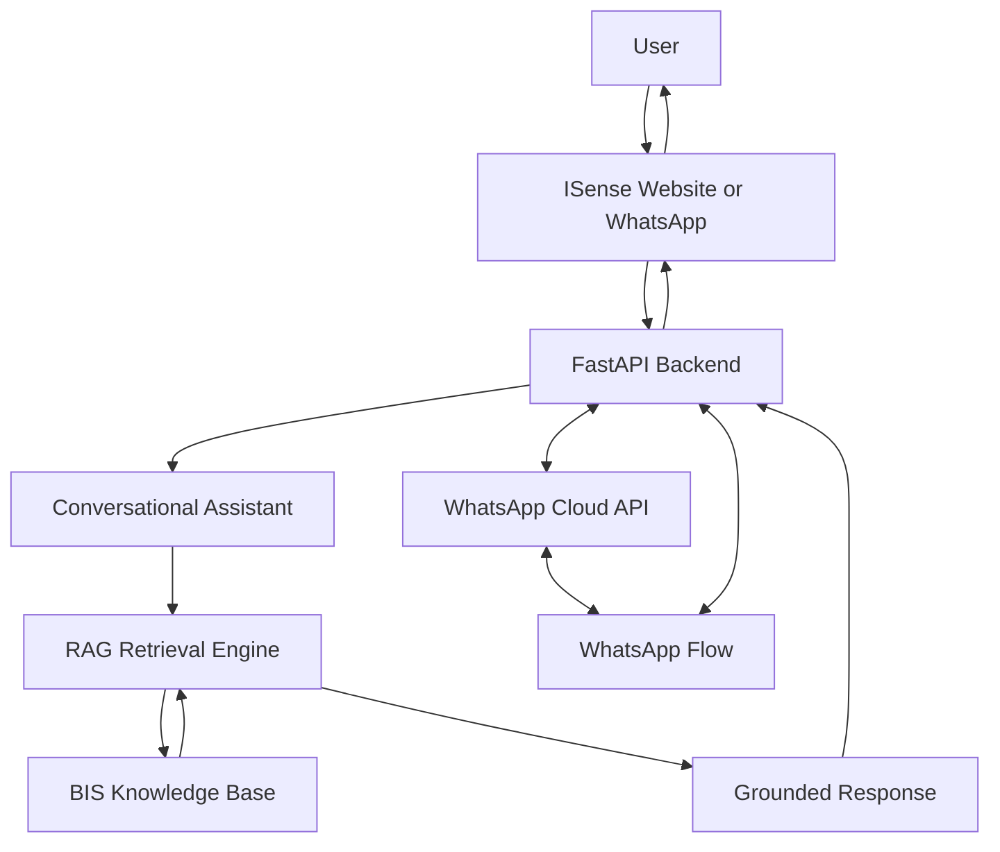

# ISense — BIS Certification Assistance Platform

**An AI-powered assistant for navigating Bureau of Indian Standards (BIS) requirements.**

ISense is a Retrieval-Augmented Generation (RAG) based assistance platform designed to help manufacturers, entrepreneurs, importers, and businesses understand BIS standards, product certification requirements, testing procedures, and compliance-related information.

The platform combines AI-powered question answering with a knowledge base of relevant regulatory documents. It also integrates WhatsApp to make BIS-related guidance more accessible through conversational interactions.

> **Development status:** The WhatsApp Cloud API integration and dynamic Flow are under development. Meta has accepted the custom Flow JSON, but publishing is currently blocked by a Meta integrity restriction. End-to-end dynamic Flow behaviour has not yet been confirmed.

## Problem Statement

Understanding BIS standards and product certification requirements can be challenging, especially for small businesses, manufacturers, and first-time applicants. Users may struggle to identify applicable standards, understand certification procedures, and locate relevant regulatory information.

ISense aims to simplify this process by providing a conversational interface that helps users explore relevant BIS requirements and find information from available source documents.

## Solution

ISense uses Retrieval-Augmented Generation to retrieve relevant information from its knowledge base and generate context-grounded responses to user questions.

The platform is designed to support:

- BIS-related question answering.
- Retrieval of relevant regulatory information from indexed documents.
- Product-specific information collection.
- Conversational assistance through WhatsApp.
- Guided exploration of certification, standards, and testing requirements.

## Key Features

### AI-Powered BIS Assistance

Users can ask questions about BIS standards, certification processes, and product compliance through a conversational interface.

### Retrieval-Augmented Generation (RAG)

The system retrieves relevant information from its knowledge base before generating responses, helping ground answers in available documentation.

### Product-Specific Assistance

The system is designed to collect product details such as category, material, intended use, and other relevant characteristics to help identify potentially applicable requirements.

### WhatsApp Integration

The WhatsApp Cloud API integration connects users to the ISense assistant through conversational messaging.

### Dynamic WhatsApp Flows

A custom WhatsApp Flow implementation is being developed to collect product-specific information through interactive forms. Publication and live end-to-end testing remain pending.

### FastAPI Backend

A Python-based backend provides API endpoints for assistant interactions, WhatsApp webhooks, and Flow data exchange.

## Technology Stack

| Technology | Purpose |
|---|---|
| Python | Backend development and AI integration |
| FastAPI | REST API and webhook handling |
| Retrieval-Augmented Generation (RAG) | Grounded question answering |
| Google Gemini integration | Language model generation |
| WhatsApp Cloud API | WhatsApp messaging integration |
| WhatsApp Flows | Interactive product information collection |
| Ngrok | HTTPS tunnelling during local development |
| Pytest | Automated testing |

## System Architecture



## Project Structure

The following is a simplified representation; exact paths may vary by project version.

```text
ISense/
├── backend/
│   ├── main.py
│   ├── whatsapp_service.py
│   ├── whatsapp_flow_endpoint.py
│   ├── generate_flow_keys.py
│   ├── rag/
│   │   └── llm_provider.py
│   ├── whatsapp_flows/
│   │   └── isense_dynamic_product_flow.json
│   ├── tests/
│   │   ├── test_dynamic_flow_endpoint.py
│   │   └── test_whatsapp_flows.py
│   ├── requirements.txt
│   ├── .env.example
│   └── WHATSAPP_DYNAMIC_FLOW_SETUP.md
└── README.md
```

Check the repository's actual filenames and adjust this illustrative tree if they differ.

## Getting Started

### Prerequisites

- Python version supported by the project's dependencies.
- Git.
- A Meta developer application with WhatsApp Cloud API access for WhatsApp integration.
- Ngrok or another HTTPS tunnel for local webhook testing.
- API credentials for the configured language model provider.

### 1. Clone the repository

```bash
git clone https://github.com/Akashmathiyalagan/ISense.git
cd ISense
```

### 2. Navigate to the backend

```bash
cd backend
```

### 3. Create and activate a virtual environment

**Windows PowerShell**

```powershell
python -m venv venv
.\venv\Scripts\Activate.ps1
```

### 4. Install dependencies

```bash
python -m pip install -r requirements.txt
```

### 5. Configure environment variables

Create a `.env` file using `.env.example` as a reference. Add the credentials required by the current backend configuration.

Example variable names (use the exact names expected by your code):

```env
GEMINI_API_KEY=your_gemini_api_key

WHATSAPP_ACCESS_TOKEN=your_meta_access_token
WHATSAPP_PHONE_NUMBER_ID=your_phone_number_id
WHATSAPP_VERIFY_TOKEN=your_webhook_verify_token
WHATSAPP_APP_SECRET=your_meta_app_secret

WHATSAPP_PRODUCT_INTAKE_FLOW_ID=your_published_flow_id
WHATSAPP_FLOW_PRIVATE_KEY_PATH=path_to_your_private_key
```

These names are examples and must match the project's actual configuration. Do not commit your `.env` file, API keys, Meta access tokens, or private encryption keys to GitHub.

### 6. Start the FastAPI server

```bash
python -m uvicorn main:app --host 127.0.0.1 --port 8001
```

Open the interactive API documentation at:

```text
http://127.0.0.1:8001/docs
```

### 7. Expose the backend for webhook testing

In a separate terminal:

```bash
ngrok http 8001
```

Configure the HTTPS forwarding URL in the relevant Meta webhook or Flow endpoint settings. The tunnel URL may change when a new tunnel session starts.

### 8. Run automated tests

From the backend directory:

```bash
python -m pytest tests/test_dynamic_flow_endpoint.py tests/test_whatsapp_flows.py -q
```

The current development tests passed in the developer's local environment (6 passed, 1 deprecation warning). Passing automated tests does not replace live integration testing with Meta.

## WhatsApp Integration

The intended workflow is:

1. A user sends a product name or BIS-related question.
2. The backend identifies whether additional product information is needed.
3. For supported product-intake scenarios, the assistant offers an interactive WhatsApp Flow.
4. The user submits product details.
5. The backend processes the submitted information.
6. The assistant uses the RAG system to generate relevant BIS guidance.

The dynamic Flow requires a correctly configured HTTPS endpoint, encryption keys, a valid Flow definition, and a published Flow ID. Complete these steps and verify the interaction before treating the feature as operational.

## Testing and Validation

The development workflow includes:

- Python syntax checks.
- JSON syntax validation.
- Automated endpoint and routing tests.
- Encryption/decryption round-trip tests.
- Meta Flow JSON validation.
- Planned live testing of WhatsApp Flow submission and RAG responses.

## Responsible Use

ISense is intended to assist users in navigating BIS-related information. Its responses should not be treated as a substitute for official regulatory decisions.

Users should verify applicable requirements against current official BIS publications and relevant government sources. Product classification, applicable standards, compulsory certification requirements, and exemptions may depend on the exact product and its intended use.

Do not present a product as certified or compliant without appropriate evidence.

## Roadmap

- [x] FastAPI backend foundation
- [x] RAG-based assistant integration
- [x] WhatsApp webhook integration
- [x] Initial dynamic Flow endpoint and routing tests
- [x] Custom Flow JSON validation by Meta
- [ ] Resolve Meta Flow publishing restriction
- [ ] Complete live encrypted Flow data-exchange testing
- [ ] Verify end-to-end WhatsApp form submission
- [ ] Improve product-specific question coverage
- [ ] Validate responses against current official BIS sources
- [ ] Production deployment and monitoring

## Contributing

Suggestions, issue reports, and contributions are welcome.

1. Fork the repository.
2. Create a feature branch.
3. Make your changes.
4. Run relevant tests.
5. Submit a pull request describing your changes.

## License

Add an appropriate open-source license before distributing this project. Without a license, others do not automatically receive permission to reuse, modify, or redistribute the code.

## Acknowledgements

- Bureau of Indian Standards (BIS) for official standards and regulatory information.
- Meta WhatsApp Cloud API for messaging and Flow integration.
- The open-source Python ecosystem for backend and testing tools.
